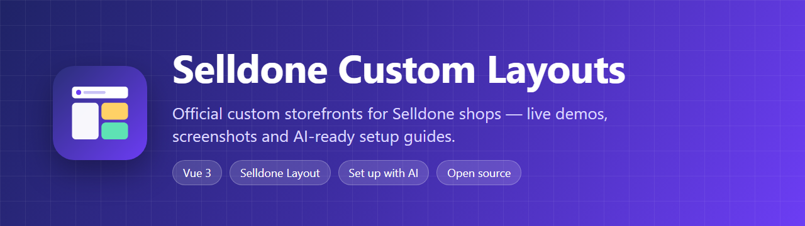

  

**Official custom storefronts for [Selldone](https://selldone.com) shops.** Each repository here is a complete storefront **Layout**, built on the official [selldone/storefront](https://github.com/selldone/storefront). Each one comes with a live shop you can try, screenshots of every page, and a wiki that walks you, or your AI agent, through putting it on your own shop.

## Layouts

<!-- LAYOUTS:START -->
<table>
<tr><td width="50%" valign="top"> <b><a href="https://github.com/selldone-custom-layouts/official-galio">Galio Sundae Patisserie</a></b> Pâtisserie · single bakery A single bakery dressed as a pastry parlour in one colour family: every ground, band and plate is a tint of the chosen palette's hue (cherry by default), with white pages taking turns with tinted bands, Shrikhand over Outfit with Caveat script kickers. One shape language (circles, pills, 28px panels): a straight side rail in the family's near-black with rounded joins (a top bar and menu sheet on phones) and a scalloped awning only under each inner page's title; a hero slider of the best-selling collections, line-drawn collections, a mosaic of the real ways to get an order, a price list with dot leaders, best sellers on round plates with tilted stickers in the brand colour, the real counter on a map and the journal. Light by default, with a dark mode in the same family and a footer Theme row; switching the palette re-tints the whole page.  <a href="https://galio.selldone.shop">Live shop</a> · <a href="https://github.com/selldone-custom-layouts/official-galio">Code</a> · <a href="https://github.com/selldone-custom-layouts/official-galio/wiki">Wiki</a> · <a href="https://github.com/selldone-custom-layouts/official-galio/wiki/Install-with-AI">Set up with AI</a></td><td width="50%" valign="top"> <b><a href="https://github.com/selldone-custom-layouts/official-domino">Domino Cocoa Patisserie</a></b> Pâtisserie · single bakery A single bakery in cocoa and pistachio: a cream ground, cocoa ink and header, a pistachio accent, rounded photos and pill buttons, Cormorant over Jost; a top bar with the shop’s hours and contact, a centred italic wordmark drawn from the shop’s live title, the collections, search, a language and currency pill and the bag; a hero of collection names over photos, counters on a scalloped cocoa band, the best-selling collections, how ordering works, today’s selection, a marquee of the collections and the journal. Light by default, with a dark mode and the palettes in the footer’s Theme row.  <a href="https://domino.selldone.shop">Live shop</a> · <a href="https://github.com/selldone-custom-layouts/official-domino">Code</a> · <a href="https://github.com/selldone-custom-layouts/official-domino/wiki">Wiki</a> · <a href="https://github.com/selldone-custom-layouts/official-domino/wiki/Install-with-AI">Set up with AI</a></td></tr>
<tr><td width="50%" valign="top"> <b><a href="https://github.com/selldone-custom-layouts/official-mikio">Mikio Ticker Patisserie</a></b> Pâtisserie · single bakery A single bakery laid out like a busy cake-shop counter: white pages, black bars and footer, cream image tiles and one cherry-red theme colour; heavy extended caps (Archivo) over Figtree, with a typewriter mono for the moving strip and stickers. A black announcement bar, a centred wordmark with a nav row, a moving ticker, a two-photo slider of the best-selling collections, rails of cream-tile cards with Add to bag, delivery photo tiles, journal features and the journal; collection pages with a two-photo hero and filters in a side panel; a product page with the collection's other pieces as tiles. Light by default, with a dark mode and a footer Theme row.  <a href="https://mikio.selldone.shop">Live shop</a> · <a href="https://github.com/selldone-custom-layouts/official-mikio">Code</a> · <a href="https://github.com/selldone-custom-layouts/official-mikio/wiki">Wiki</a> · <a href="https://github.com/selldone-custom-layouts/official-mikio/wiki/Install-with-AI">Set up with AI</a></td><td width="50%" valign="top"> <b><a href="https://github.com/selldone-custom-layouts/official-bakini">Bakini Noir Patisserie</a></b> Pâtisserie · single bakery A single bakery dressed as a dark pastry theatre: a deep stage with ivory type, deep caramel for every action and gold for small accents; Instrument Serif over Manrope; a glass header with the collections, search, a language and currency pill and the bag; a cinematic hero, the collections as tall dark cards, a bento of the shop's real facts, selection rows, a compare strip, deals and the journal; real spec filters, a product page with a sticky buy column and Buy together, a bag drawer, glass checkout cards and a desk account. Dark by default, with an ivory light mode and a footer Theme row.  <a href="https://bakini.selldone.shop">Live shop</a> · <a href="https://github.com/selldone-custom-layouts/official-bakini">Code</a> · <a href="https://github.com/selldone-custom-layouts/official-bakini/wiki">Wiki</a> · <a href="https://github.com/selldone-custom-layouts/official-bakini/wiki/Install-with-AI">Set up with AI</a></td></tr>
<tr><td width="50%" valign="top"><b><a href="https://github.com/selldone-custom-layouts/official-fresh-bazaar">official-fresh-bazaar</a></b> Old Bazaar 3D — a walkable Persian bazaar that is a real Selldone shop (live: bazaar.bigmart.me): an ongoing experiment in how close AI and 3D engines can get to a photograph, rebuilt with every new Claude and Codex model  <a href="https://bazaar.bigmart.me">Live shop</a> · <a href="https://github.com/selldone-custom-layouts/official-fresh-bazaar">Code</a> · <a href="https://github.com/selldone-custom-layouts/official-fresh-bazaar/wiki">Wiki</a> · <a href="https://github.com/selldone-custom-layouts/official-fresh-bazaar/wiki/Install-with-AI">Set up with AI</a></td><td width="50%" valign="top"> <b><a href="https://github.com/selldone-custom-layouts/official-tario">Tario Market</a></b> Grocery marketplace · big-box red The molino grocery marketplace built like a big-box store: a red promo strip, a hero that turns, round categories, rows of cards with a red Add to cart that turns into − n +, aisle pages with a chip bar of filters, a product page with a framed buy box and sellers side by side, and a cart page with a free-shipping meter.  <a href="https://tario.selldone.shop">Live shop</a> · <a href="https://github.com/selldone-custom-layouts/official-tario">Code</a> · <a href="https://github.com/selldone-custom-layouts/official-tario/wiki">Wiki</a> · <a href="https://github.com/selldone-custom-layouts/official-tario/wiki/Install-with-AI">Set up with AI</a></td></tr>
<tr><td width="50%" valign="top"> <b><a href="https://github.com/selldone-custom-layouts/official-walio">Walio Market</a></b> Grocery marketplace · blue superstore The molino grocery marketplace as a blue superstore: a split hero with deal tiles, best savings, category tiles and shop-the-idea lists, aisles with a banner and a filter column, a classic product page with delivery choices, a cart window under the cart button, a stepped checkout, and seller pages as a shop in the shop.  <a href="https://walio.selldone.shop">Live shop</a> · <a href="https://github.com/selldone-custom-layouts/official-walio">Code</a> · <a href="https://github.com/selldone-custom-layouts/official-walio/wiki">Wiki</a> · <a href="https://github.com/selldone-custom-layouts/official-walio/wiki/Install-with-AI">Set up with AI</a></td><td width="50%" valign="top"> <b><a href="https://github.com/selldone-custom-layouts/official-dino">Dino Market</a></b> Grocery marketplace · purple quick-delivery app The molino grocery marketplace as a purple quick-delivery app: a violet bar with a delivery pill and a cart pill with the total, swipeable promo cards, the aisles as a tile grid, app cards with a round yellow + on the picture, an aisle column beside every listing, a rounded cart sheet with a free-shipping bar, a violet seller banner, and a friendly dinosaur on About, sign-in and the 404.  <a href="https://dino.selldone.shop">Live shop</a> · <a href="https://github.com/selldone-custom-layouts/official-dino">Code</a> · <a href="https://github.com/selldone-custom-layouts/official-dino/wiki">Wiki</a> · <a href="https://github.com/selldone-custom-layouts/official-dino/wiki/Install-with-AI">Set up with AI</a></td></tr>
<tr><td width="50%" valign="top"> <b><a href="https://github.com/selldone-custom-layouts/official-valero">Valero Market</a></b> Grocery marketplace · black editorial food hall The molino grocery marketplace as an after-dark food hall: a black page with ivory type and champagne hairlines, an editorial hero, the aisles as a numbered index, hairline grids of cards on ivory wells, a split product page with the sellers as a table, a full-height bag panel, a numbered checkout, makers' pages and a magazine-style journal.  <a href="https://valero.selldone.shop">Live shop</a> · <a href="https://github.com/selldone-custom-layouts/official-valero">Code</a> · <a href="https://github.com/selldone-custom-layouts/official-valero/wiki">Wiki</a> · <a href="https://github.com/selldone-custom-layouts/official-valero/wiki/Install-with-AI">Set up with AI</a></td><td width="50%" valign="top"> <b><a href="https://github.com/selldone-custom-layouts/official-molino">Molino Market Hall</a></b> Grocery marketplace A multi-vendor grocery storefront in the spirit of Amazon Fresh: a deals banner, every aisle, rows of products with the seller on every card, an Amazon-style Add to basket, a map-first checkout and a buyer account.  <a href="https://molino.selldone.shop">Live shop</a> · <a href="https://github.com/selldone-custom-layouts/official-molino">Code</a> · <a href="https://github.com/selldone-custom-layouts/official-molino/wiki">Wiki</a> · <a href="https://github.com/selldone-custom-layouts/official-molino/wiki/Install-with-AI">Set up with AI</a></td></tr>
<tr><td width="50%" valign="top"> <b><a href="https://github.com/selldone-custom-layouts/official-medio">Medio Electronics</a></b> Electronics store · big high-street retailer A single-shop electronics store dressed as a big high-street electronics retailer: one deep violet for every action, magenta savings and rounded white cards on a light grey page; a header with a rotating message strip, Shop All, Services and Deals panels and a big round search; a deals-first home (campaign strip, hero deals, round category tiles, promo tiles, brand deals, dark deal cards with real clocks, tabbed rails, pastel promise tiles, buying guides); a category hub over every results page; results with a Filters card and a List / Grid toggle (a list row with a price column); a product page with a sticky buy card, add-ons, Buy together and accordions; a basket drawer, a desk account, Help & Support and a designed 404. English, Arabic (RTL), Hindi and Danish.  <a href="https://medio.selldone.shop">Live shop</a> · <a href="https://github.com/selldone-custom-layouts/official-medio">Code</a> · <a href="https://github.com/selldone-custom-layouts/official-medio/wiki">Wiki</a> · <a href="https://github.com/selldone-custom-layouts/official-medio/wiki/Install-with-AI">Set up with AI</a></td><td width="50%" valign="top"> <b><a href="https://github.com/selldone-custom-layouts/official-senso">Senso Electronics</a></b> Electronics shop · brand site · teal An electronics shop dressed as a calm, cinematic brand site: a clear header over a full-bleed hero carousel, product families with clean mega panels, featured and lifestyle image cards over pale category tiles, offers and new-arrival rails, line-icon category tiles, dark category banners with kinds and a filter card, a product page with a sticky info column, Highlights bands, a two-column spec table and Compare with similar, and a support centre.  <a href="https://senso.selldone.shop">Live shop</a> · <a href="https://github.com/selldone-custom-layouts/official-senso">Code</a> · <a href="https://github.com/selldone-custom-layouts/official-senso/wiki">Wiki</a> · <a href="https://github.com/selldone-custom-layouts/official-senso/wiki/Install-with-AI">Set up with AI</a></td></tr>
<tr><td width="50%" valign="top"> <b><a href="https://github.com/selldone-custom-layouts/official-argon">Argon Electronics</a></b> Electronics store · bright catalogue store A single-shop electronics store dressed as a bright, busy catalogue retailer: a red logo tile and a wide search, a category carousel with packshot tiles, dark promo cards, a green deal strip that names the deals' real end date, photo cards, product rails with Deal, New and Best seller badges and green Add to cart buttons, trending tags, brands and services; a results page with a row of filter dropdowns and an All filters side sheet; a two-column product page (gallery card left, stacked buy cards right) with Complete your purchase; a side-by-side compare page; a receipt-first cart and a desk-style account.  <a href="https://argon.selldone.shop">Live shop</a> · <a href="https://github.com/selldone-custom-layouts/official-argon">Code</a> · <a href="https://github.com/selldone-custom-layouts/official-argon/wiki">Wiki</a> · <a href="https://github.com/selldone-custom-layouts/official-argon/wiki/Install-with-AI">Set up with AI</a></td><td width="50%" valign="top"> <b><a href="https://github.com/selldone-custom-layouts/official-besti">Besti Electronics</a></b> Electronics store · white department store A single-shop electronics store dressed as a big white department store: a Deal of the Day strip, a photo hero by department, departments in two even rows, top deals by category, best sellers from the shop's tag, brands and guides; bordered product tiles with colour swatches that pick the colour; filters built from the products' own specs; a three-column product page with a sticky buy box, specs, reviews and bought-together; a side-by-side compare page; a receipt-first cart and a desk-style account.  <a href="https://besti.selldone.shop">Live shop</a> · <a href="https://github.com/selldone-custom-layouts/official-besti">Code</a> · <a href="https://github.com/selldone-custom-layouts/official-besti/wiki">Wiki</a> · <a href="https://github.com/selldone-custom-layouts/official-besti/wiki/Install-with-AI">Set up with AI</a></td></tr>
<tr><td width="50%" valign="top"> <b><a href="https://github.com/selldone-custom-layouts/official-digito">Digito Electronics</a></b> Electronics shop · deals hub · blue An electronics shop built like a big deals hub: a blue header with a category mega menu, a photo hero beside the Deal of the Day, two even rows of round categories, deal rails with an Add to cart that turns into − n +, doorbusters, a best-seller bento, category pages with a filter panel, a three-column product page with specs and Frequently bought together, and a receipt-first cart.  <a href="https://digito.selldone.shop">Live shop</a> · <a href="https://github.com/selldone-custom-layouts/official-digito">Code</a> · <a href="https://github.com/selldone-custom-layouts/official-digito/wiki">Wiki</a> · <a href="https://github.com/selldone-custom-layouts/official-digito/wiki/Install-with-AI">Set up with AI</a></td><td width="50%"></td></tr>
</table>

15 public Layouts · this list updates itself.
<!-- LAYOUTS:END -->

## Put a Layout on your shop

1. **Pick one** above and open its **live shop** to try it.
2. **Set it up with AI:** open the Layout's wiki page **Install with AI**, fill in your shop handle and shop id, and paste the prompt into Claude Code, Codex or another coding agent. The agent forks the repository, points it at your shop, builds it, uploads it with the official [selldone-cli](https://github.com/selldone/cli) and puts it live. You only sign in to the CLI yourself and type your 2FA code.
3. **Or do it yourself** with the wiki's **Manual Setup**, **Build and Upload** and **Go Live** pages.
4. **Check your data** with **Shop Requirements**: category icons, product photos, units, seller offers and specs for filters.

## What every Layout here has

- A **live demo shop** and **screenshots** from it, on desktop and phone.
- A complete **wiki**: Install with AI, Manual Setup, Shop Requirements, Build and Upload, Go Live, Customize, Troubleshooting.
- A `selldone-layout.json` card, which puts it in the gallery above once the repository is public.
- Selldone's commerce logic intact: basket, checkout, payments, vendor offers and orders. Only the design changes.

## Links

[Selldone](https://selldone.com) · [Storefront base](https://github.com/selldone/storefront) · [Selldone CLI](https://github.com/selldone/cli) · [Add a Layout to this organization](https://github.com/selldone-custom-layouts/.github/blob/main/CONTRIBUTING.md)
